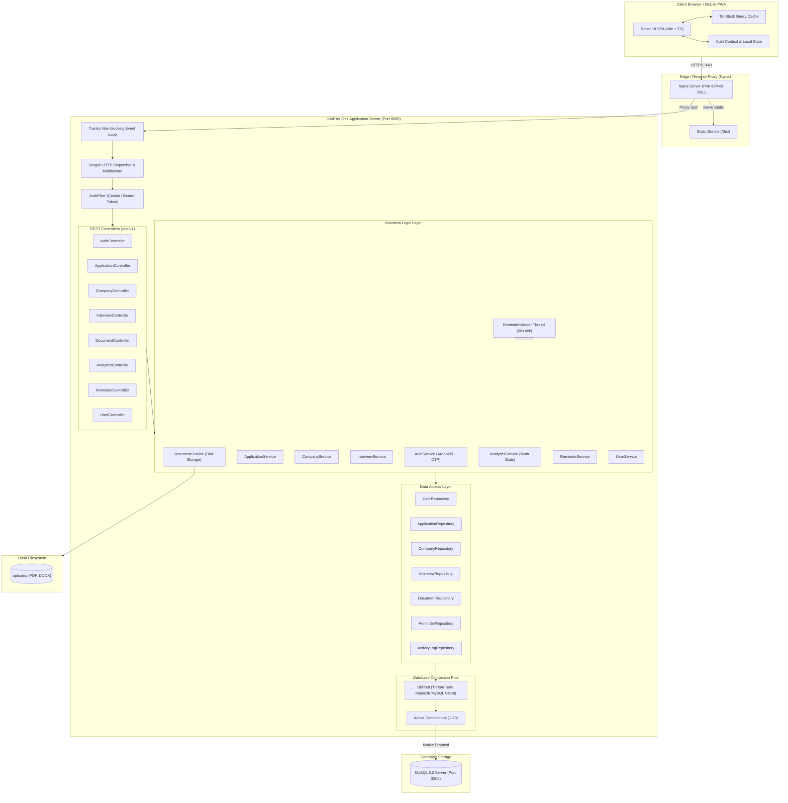

# JobPilot System Architecture

## 1. Executive Summary & Design Principles

**JobPilot** is an enterprise-grade, high-performance Personal Job Application Management System and Career Operating System built with a native modular monolith architecture.

### Non-Negotiable Core Principles:
- **Zero Overhead & Pure Native Execution**: Engineered in **C++20** using the Drogon asynchronous framework and compiled to native machine binaries. No virtual machines, no Node.js runtime on the server, no Python interpreters, and strictly no Docker container layers.
- **Relational Integrity First**: Powered by **MySQL 8.x** with full ACID compliance, strict foreign key constraints, explicit indexing, and transactions for multi-step state mutations.
- **CLI-First Database Operations**: Complete transparency for database maintenance via native MySQL CLI tools (`mysql`, `mysqldump`).
- **Cryptographic Security**: Passwords hashed with **Argon2id**, sessions signed with 256-bit cryptographically secure tokens, and sensitive routes protected via HttpOnly, SameSite cookies.
- **Ultra-Responsive Frontend**: Built with **React 18**, **TypeScript**, **Vite**, **Tailwind CSS**, and **TanStack Query**, providing optimistic updates, instant routing, and dark/light glassmorphic UI.

---

## 2. High-Level System Architecture



---

## 3. Backend Architecture (C++20 / Drogon)

### 3.1 Event Loop & Concurrency Model
The backend uses Drogon's underlying **Trantor** reactive network library. Trantor runs a thread pool of non-blocking I/O event loops (utilizing `epoll` on Linux, `kqueue` on macOS, and `IOCP` / select on Windows):
1. **Network I/O**: Connections and incoming HTTP payloads are processed asynchronously on the network thread pool.
2. **Worker Pool**: Computationally intensive tasks and database queries are dispatched efficiently without blocking the I/O event loops.
3. **Background Worker**: An autonomous C++ thread (`ReminderWorker`) runs periodically every 60 seconds to scan the `reminders` table for due notifications and log them to `activity_logs`.

### 3.2 Tiered Layer Responsibility
- **Controllers** (`backend/include/controllers/`): Validate incoming JSON request payloads, parse query parameters (e.g. `page`, `limit`, `status`, `search`), extract user identities from the request context, and invoke the appropriate service method.
- **Services** (`backend/include/services/`): Coordinate business operations, enforce state machine transitions (e.g. `SAVED -> APPLIED -> INTERVIEW -> OFFER`), manage password hashing, generate OTPs, perform statistical analytics, and write files to `uploads/`.
- **Repositories** (`backend/include/repositories/`): Construct parameterized SQL queries, handle parameter escaping via `mysql_real_escape_string`, map raw MySQL result sets (`MYSQL_ROW`) to C++ domain structs, and manage database transactions.
- **Connection Pool** (`backend/include/utils/DbPool.h`): An RAII-managed, thread-safe connection pool utilizing `std::mutex` and `std::condition_variable`. Connections are acquired via `DbPool::acquire()` returning a smart `DbConnection` wrapper that automatically returns the connection upon going out of scope.

### 3.3 Cryptographic Standards
- **Argon2id**: Memory-hard password hashing via `argon2_hash_encoded` (Type: Argon2id, Version: 13, Time cost: 2, Memory cost: 65,536 KiB, Parallelism: 1).
- **Session Tokens**: 256-bit cryptographically secure random bytes generated via OpenSSL `RAND_bytes`, hex-encoded to a 64-character token. The raw token is stored in the user's browser cookie while the SHA-256 hash is persisted in the `user_sessions` table.
- **One-Time Passwords (OTP)**: Cryptographically uniform 6-digit numeric codes (`100000` to `999999`) generated with OpenSSL CSPRNG. Only the SHA-256 hash is saved in `otp_verifications`.

---

## 4. Frontend Architecture (React 18 / TypeScript / Vite)

### 4.1 State & Caching Architecture
- **Server Cache (TanStack Query v5)**: Manages all asynchronous REST endpoints (`applications`, `companies`, `interviews`, `analytics`, `reminders`). Provides automatic background cache invalidation on mutations, eliminating stale state.
- **Authentication State (React Context)**: The `AuthContext` provides global user identity, session state, theme mode (`dark` vs `light`), and user preferences.
- **Optimistic UI Updates**: Kanban board drag-and-drop status changes update immediately in the local cache while the PUT request executes in the background.

### 4.2 Component & Layout Hierarchy
```
App
├── QueryClientProvider
│   └── AuthProvider
│       └── BrowserRouter
│           ├── Public Routes (LandingPage)
│           ├── Auth Layout (LoginPage, RegisterPage, OtpPage, ResetPasswordPage)
│           ├── App Layout (Navbar, Sidebar, Quick Action Modal, Theme Toggle)
│           │   ├── DashboardPage (KPI metrics, funnel, upcoming interviews)
│           │   ├── ApplicationsPage (Filterable table, search, pagination)
│           │   ├── ApplicationDetailsPage (Tabs: Overview, Timeline, Notes)
│           │   ├── KanbanPage (7-column drag & drop lifecycle board)
│           │   ├── CompaniesPage (Directory, recruiter contacts, website links)
│           │   ├── InterviewsPage (List & detail modal with meeting links)
│           │   ├── CalendarPage (Monthly visual view with interview badges)
│           │   ├── DocumentsPage (Resume & cover letter storage)
│           │   ├── AnalyticsPage (Interactive Recharts: Sankey funnel, response rate)
│           │   ├── RemindersPage (Follow-up management with quick actions)
│           │   └── ProfilePage (Account preferences, JSON/CSV data backup)
│           └── NotFoundPage (404 catch-all)
```

---

## 5. Security & Isolation Architecture

1. **User Isolation (Multi-Tenancy Guard)**:
   Every repository query enforces `WHERE user_id = ?`. User IDs supplied in URL parameters or request bodies are completely ignored; the user ID is securely resolved solely from the validated session cookie in `AuthFilter`.
2. **Path Traversal Prevention**:
   Uploaded documents are stored with random UUID-based filenames on disk (`uploads/<uuid>.<ext>`), and the original filename is stored only as metadata in MySQL. Files are accessed via validated document IDs checked against the owning user.
3. **Session Hardening**:
   - `HttpOnly`: Prevents JavaScript XSS access to the session token.
   - `SameSite=Lax`: Protects against Cross-Site Request Forgery (CSRF).
   - `Secure`: Transmitted solely over HTTPS in production.
4. **Input Sanitization**:
   All string parameters in SQL queries are processed via `mysql_real_escape_string`.

---

## 6. Performance & Scale Targets

| Metric | Target | Architecture Provision |
| :--- | :--- | :--- |
| **API Response Time** | < 10ms (p95) | Native C++20 compiled binary with asynchronous Drogon router |
| **Frontend Bundle Size** | < 250 KB (gzipped) | Vite tree-shaking, code splitting, Lucide icon imports |
| **Memory Footprint** | < 40 MB RSS (Backend) | Lightweight C++ memory model without VM or runtime bloat |
| **Database Pool Efficiency** | 0 connection starvation | RAII `DbConnection` auto-return, configurable pool cap (20) |
