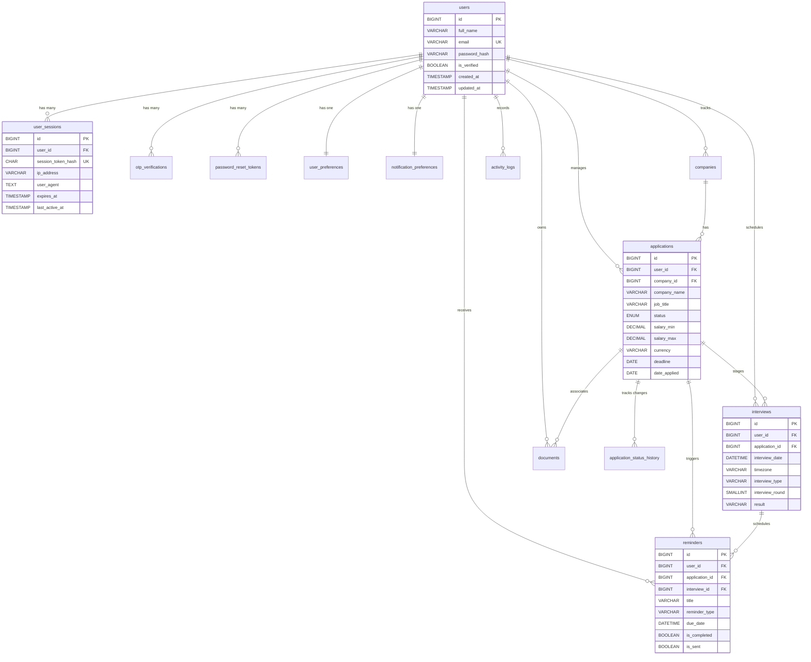

# JobPilot Entity Relationship Documentation

This document describes the schema architecture and relationships of the JobPilot database.

### Key Relational Safeguards
1. **Multi-User Isolation**: Every top-level entity (`applications`, `companies`, `interviews`, `documents`, `reminders`) has a direct `user_id` foreign key referencing `users(id)` with `ON DELETE CASCADE`. Queries MUST filter by `user_id` to guarantee tenant isolation.
2. **Orphan Prevention**: When an application is deleted, associated `interviews`, `reminders`, and `application_status_history` are automatically cascade-deleted.
3. **Graceful Company Decoupling**: If a `company` record is deleted, its associated `applications` have `company_id` set to `NULL` (`ON DELETE SET NULL`) while preserving the denormalized `company_name` in the application record.
